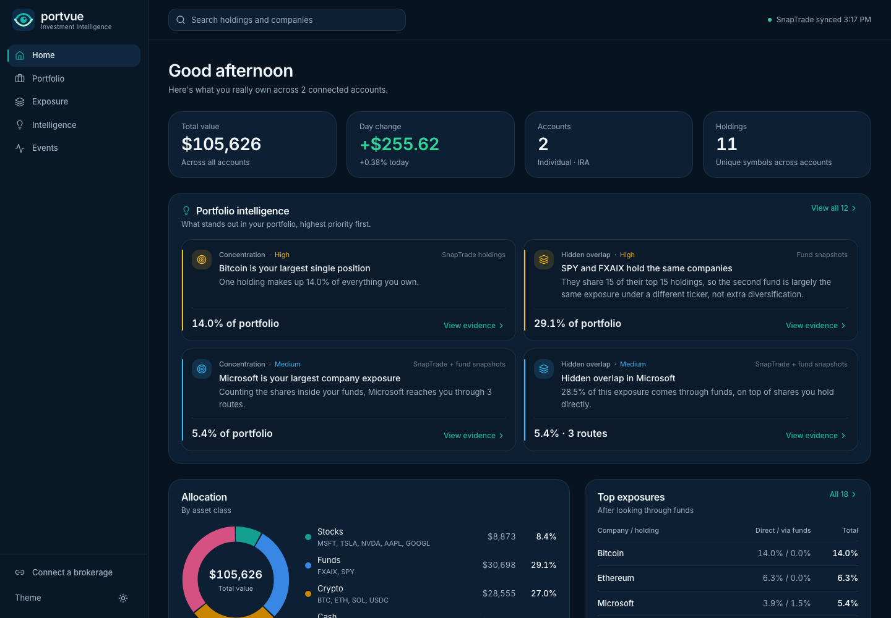
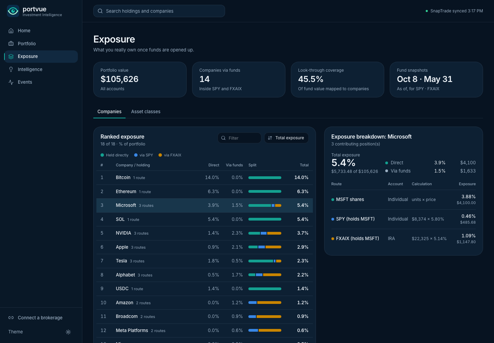
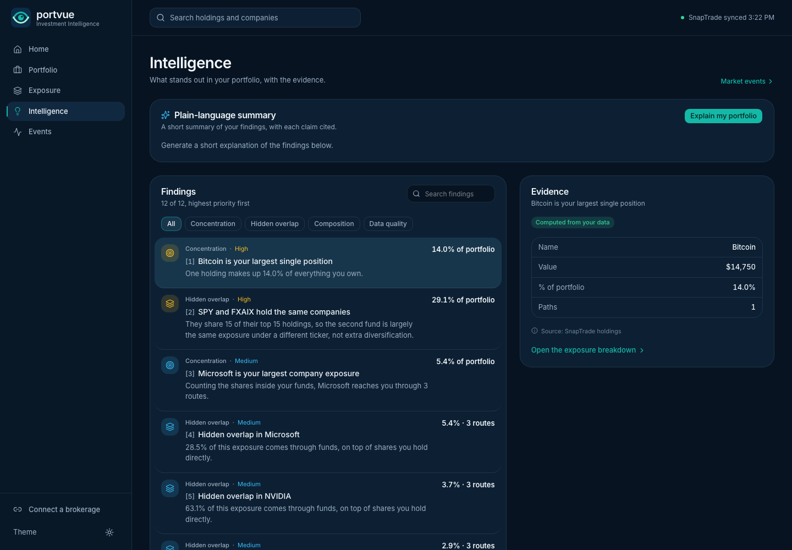

# Portvue

**See beyond what you own.** Portvue connects brokerage accounts through [SnapTrade](https://snaptrade.com), combines every holding across accounts, and looks through ETFs and index funds to the companies inside them. It shows where diversification is really the same exposure held two or three times, and explains the findings in plain language, with the evidence behind every number.

Built for SnapTrade × Hack Atlantic 2026. Read-only: Portvue never places or cancels orders.



## What it does

- **Home.** Total value, day change, accounts and holdings; a prioritized intelligence feed; allocation by asset class; a 90-day value history; top exposures and concentration.
- **Exposure.** A ranked look-through table (direct vs. via funds, searchable and sortable). Selecting a company shows every contributing position, its account and the calculation (for example `$22,325 × 5.14%`). An asset-class view sits alongside.
- **Intelligence.** Filterable findings with an evidence panel, plus a plain-language summary written by Claude in which every sentence cites the findings it relies on.
- **Events.** Today's and this week's moves (current units × market price change), the top drivers, possible news drivers found with Claude's web search and linked to their sources, and per-holding sparklines.
- **Portfolio.** Account cards and the combined holdings table.

On the SnapTrade Sandbox (Self-directed scenario, $105,626 across two accounts), Portvue finds Microsoft reaching the user through three routes (direct shares, SPY and FXAIX), and SPY and FXAIX sharing all 15 of their top holdings, together 29.1% of the portfolio.



## How SnapTrade is used

| Call | Why |
|---|---|
| `authentication.loginSnapTradeUser({ broker: "SANDBOX", connectionType: "read", customRedirect })` | Opens the Connection Portal with a read-only connection (`/api/connect`). |
| `accountInformation.listUserAccounts()` | Lists connected accounts and their reported totals. |
| `accountInformation.getAllAccountPositions({ accountId })` | Units, price, instrument kind and the `cash_equivalent` flag for each position. |
| `accountInformation.getUserAccountBalance({ accountId })` | Cash per account. |

Calls run sequentially and the portfolio is cached for 5 minutes server-side to stay within rate limits. Positions flagged `cash_equivalent` (money-market funds) are excluded from invested value because the broker already counts them in cash, so Portvue's total matches SnapTrade's reported `balance.total`. Non-USD positions and balances are skipped with a visible warning (no FX conversion).

### Authentication: personal today, commercial-ready

For the hackathon, Portvue uses a SnapTrade **personal API key**: one owner, their own accounts, no user management. Multi-user support with commercial keys and a login was out of scope for the time available, but the code is structured so the switch stays contained. All SnapTrade access goes through three places:

- `lib/snaptrade.ts`: the one SDK client
- `lib/portfolio.ts`: the account, position and balance calls
- `app/api/connect/route.ts`: the Connection Portal link

Moving to commercial keys means:

1. Swap `SnaptradeAuth.personalApiKey` for `SnaptradeAuth.commercialApiKey` in `lib/snaptrade.ts`.
2. Add sign-in, and on first login call `registerSnapTradeUser` once per user, storing the returned `userSecret` server-side.
3. Pass that user's `userId` and `userSecret` to the calls in `lib/portfolio.ts` and `app/api/connect`.
4. Key the portfolio cache, market-data store and rate limits by user instead of globally.

The look-through engine, findings, moves and AI routes work on the combined portfolio object, so they don't change.

## How the numbers are made

- **Look-through** (`lib/xray.ts`). Each fund position is split by its snapshot weights, so a company's exposure is direct value plus Σ(fund value × weight), aggregated across accounts. Snapshot rows carry a `company` key so share classes merge (GOOG and GOOGL become Alphabet). The weight a snapshot doesn't cover is shown as "rest of fund holdings", so company figures are lower bounds.
- **Findings** are computed in code, each with an id and its numbers: largest exposure, hidden overlaps, fund-to-fund overlap, top-3 concentration, cash share, uncovered remainder, and a stale-snapshot warning.
- **Moves** (`lib/moves.ts`). Impact = current SnapTrade units × market price change. It is price-move attribution on current holdings, not a time-weighted return: deposits, withdrawals and dividends are not modelled. The day-change percentage is net impact ÷ prior value of priced holdings, excluding cash.
- **AI** (`app/api/explain`, `app/api/drivers`). Claude never sees raw positions and never does math. It receives only the computed findings (id, title, numbers) and returns structured sentences with finding ids, which the server checks against the real findings before display. News uses Claude's web search tool; source links come from the API's citation objects, and the wording is limited to "possible drivers". Both routes are rate-limited per visitor, with a global daily cap.

## Data sources and sample data

| Data | Source | Notes |
|---|---|---|
| Accounts, positions, cash | SnapTrade (Sandbox) | Live from the API. |
| **Fund contents** | `data/etf-holdings.json` | **Sample snapshot, not live:** each fund's top 15 holdings. SPY as of 2026-10-08 (State Street daily holdings file); FXAIX as of 2026-05-31 (Fidelity N-PORT filing on SEC EDGAR). Refreshed manually; labelled in the UI with date and source. |
| Daily moves | Finnhub `/quote` | Crypto through Binance pairs; mutual funds use their last published close. |
| Weekly moves, daily closes | Alpha Vantage `TIME_SERIES_DAILY` / `DIGITAL_CURRENCY_DAILY` | Free tier: 25 calls a day. |
| Value history | Stored closes | **Hypothetical:** today's units at past closing prices, cash held constant. |

Market data, price history, news answers and rate-limit counts are stored in SQLite through libSQL: a hosted [Turso](https://turso.tech) database when `TURSO_DATABASE_URL` is set, otherwise the local file `data/portvue.db`. Rows are keyed per ticker per market day, so reloads don't spend API quota.

## Setup

Requires Node 20 or newer.

```bash
npm install
cp .env.example .env.local   # then fill in the keys below
npm run dev
```

| Variable | Purpose |
|---|---|
| `SNAPTRADE_CLIENT_ID`, `SNAPTRADE_CONSUMER_KEY` | SnapTrade personal API key |
| `ANTHROPIC_API_KEY`, `ANTHROPIC_MODEL` | Claude for explanations and news search (`claude-haiku-5-5` by default) |
| `FINNHUB_API_KEY` | Daily quotes (free key) |
| `ALPHAVANTAGE_API_KEY` | Weekly moves and price history (free key) |
| `APP_URL` | Optional: where SnapTrade redirects after connecting (defaults to the request's origin) |
| `TURSO_DATABASE_URL`, `TURSO_AUTH_TOKEN` | Optional locally, needed in production: the shared Turso database (`libsql://…`) |

Then open http://localhost:3000/api/connect, choose the **Self-directed** Sandbox scenario, and you'll return to the app. `npm run inspect` prints every connected account and position.

## Deployment

Deployed on Vercel with a Turso database, so every instance shares one persistent store and market data is fetched once per ticker per day across all of them. Create one with the Turso CLI (`turso db create portvue`, then `turso db show portvue --url` and `turso db tokens create portvue`) and set `TURSO_DATABASE_URL` and `TURSO_AUTH_TOKEN` in the Vercel project. The tables are created on first use. Turso is required on Vercel; locally the app uses `data/portvue.db` when it isn't set.

## Limitations

- Fund contents are dated top-15 snapshots of two funds; other funds are not looked through.
- Issuers are matched by ticker and a manual `company` key, not CUSIP or FIGI.
- Moves use current holdings; cash flows, dividends and corporate actions are not modelled; USD only.
- On the Sandbox, the day-change base uses SnapTrade's simulated prices while impacts use real market moves.
- The numbers inside Claude's sentences are constrained by the prompt and cited findings, but not automatically checked against the findings.
- Single user via a personal API key; see [Authentication](#authentication-personal-today-commercial-ready) for the commercial path.

Educational, not financial advice.


